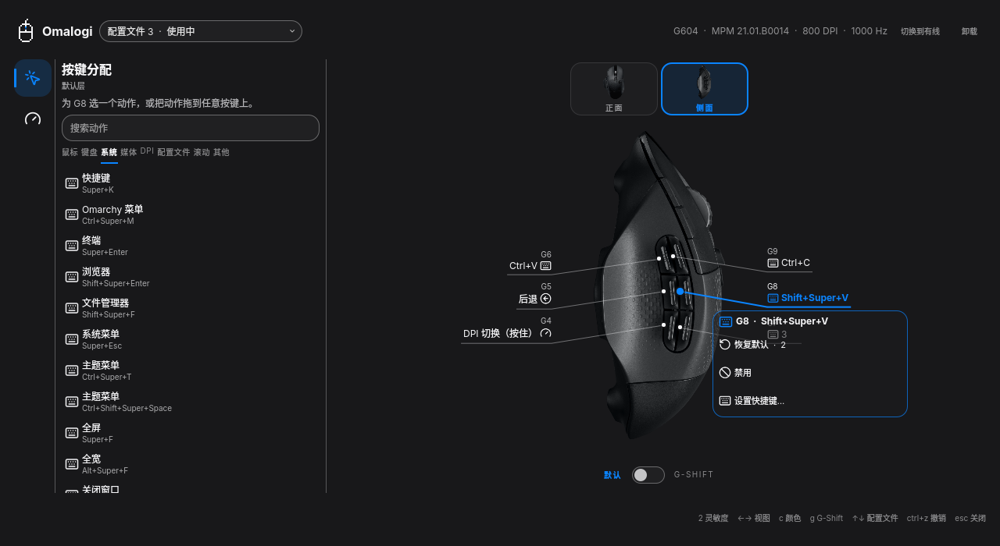

# 14 · Omalogi：罗技 G 系列鼠标配置（汉化 + ARM 构建）

简体中文 | [English](en/14-omalogi.md)

## 目标

[Omalogi](https://github.com/elberacasa/omalogi) 是 Omarchy 上的罗技 G 系列鼠标配置工具（类似 G HUB）：编辑板载配置文件、DPI 档位、回报率、按键与 G-Shift 绑定，按当前应用 / 显示器自动切换配置文件，菜单栏有指示器。这里做了这些优化：

- **适配 ARM（aarch64）**：上游只发布 x86_64 预编译助手，插件自带的 `install.sh` 在 ARM 上直接退出。改为固定到 0.3.8 的提交从源码构建（Rust 1.99+，本机约 40 秒），插件里的「允许访问 / 安装助手」按钮也会转到这条路
- **简体中文界面**：所有文字、动作库、分组、提示、报错和菜单栏提示都是中文
- **普通窗口**：不再是压在所有工作区上面的全屏浮层，而是「罗技鼠标」应用窗口，可平铺 / 浮动 / 全屏、进 Alt+Tab，菜单栏和 Dock 显示它自己的名字和图标
- **有线 + 无线**：同时连着有线鼠标和接收器后面的无线鼠标（如 G604）时，可以切换编辑哪一只
- **启动台入口与图标**：应用程序面板 / Spotlight 里有「罗技鼠标」，图标是和 MacTahoe 统一风格的亮蓝瓦片

## 快速上手

在 Omarchy 4.x（Hyprland Lua 配置）上，进入 Silky Omarchy 仓库，使用 Rust 1.99 或更新版本构建并安装。安装 udev 规则时可能需要 sudo。

```bash
./scripts/install-omalogi.sh
silky-omalogi
```

1. **选设备。** G604 使用 Lightspeed 接收器。如果同时插着有线鼠标，点击窗口右上角「切换到无线」。
2. **启用板载配置。** 在窗口顶部选择一个「已关闭」的配置，点「启用并激活」。已启用的配置可以直接点「激活」。编辑其他配置时，修改会保存到所选配置，切换到它后才会生效。
3. **找到实体按键。** G604 正面显示左右键、滚轮和 DPI 键，侧面显示 G4–G9。引线会跟着标签宽度收尾。点圆点或文字选中按键，也可以把左侧动作拖到标注上。
4. **手动组合快捷键。** 在标注菜单点「设置快捷键…」，选 Ctrl、Shift、Alt、Super，再选主键。常用按钮包含 PgUp、PgDn、Home、End 和截图。截图按钮选用单独的 Print Screen，执行哪种截图由桌面的按键绑定决定。录制后也可先检查或修正组合，再点「应用」。
5. **直接选系统动作。** 「系统」标签读取打开窗口时 `Super+K` 菜单的当前快捷键，显示动作名称和组合。选中一个鼠标按键后，点击或拖放「终端」「截图」等动作即可。搜索框同时支持名称和组合键。列表只收录 Omalogi 能保存的键盘组合。



[查看手动组合键和特殊键选择器](images/omalogi-shortcut.png)

## 实测硬件

| 鼠标 | 连接 | 结果 |
| --- | --- | --- |
| G502 HERO | USB 有线（046d:c08b） | 上游已验证型号；读写正常；`assets.openlogi.org` 没有它的侧视图，所以没有鼠标图片 |
| G604 | Lightspeed 接收器（WPID 4085） | 上游“未测试”型号，这里实测后标为已验证（补丁把 `untested(0x4085)` 改成 `verified`，不再显示「未测试 · 帮忙验证」，也不用确认）；`omalogi check` 29 项全过；正面与侧面图标注 15 个可编程控件 |

机器：ARM 笔记本（aarch64），Omarchy 4.5、Hyprland 0.57（Lua 配置）、Quickshell 0.3.2、MacShell 0.5.2、Rust 1.99.1。

## 结构

Omalogi 分两部分：Rust 写的助手 `omalogi`（通过 HID++ 2.0 读写鼠标，含 `serve`、`daemon` 和 CLI），以及 Omarchy Shell 插件（QML）。插件文件在编译时用 `include_str!` 嵌进助手，由 `omalogi setup` 写到 `~/.config/omarchy/plugins/io.github.elberacasa.omalogi`，所以**汉化必须在构建前打补丁**，直接改已安装的插件会在下次 `setup` 时被覆盖。

| 文件 | 作用 |
| --- | --- |
| `patches/omalogi-0.3.8-zh.patch` | 针对上游 `ff3d8c2`（v0.3.8）的汉化、设备切换、G604 按键图及快捷键补丁 |
| `config/icons/omalogi.svg` | 应用图标原稿：罗技青→蓝渐变底（和 Zoom、腾讯会议同一类亮色瓦片）+ 白色 G 系列游戏鼠标 + 罗技 LIGHTSYNC 风格的青→蓝→紫→粉灯带 |
| `config/applications/io.github.elberacasa.omalogi.desktop` | 应用程序面板 / Spotlight 入口「罗技鼠标」，运行 `silky-omalogi` |
| `omalogi-app/shell.qml`、`bin/silky-omalogi` | 独立窗口应用（自己的 app id）和它的启动 / 聚焦脚本 |
| `config/hypr/silky-omalogi.lua` | 窗口规则：居中浮动 1280×700 |
| `scripts/install-omalogi.sh` | 拉取上游 → 检出固定提交 → 打补丁 → `cargo build --release --locked` → 装到 `~/.local/bin` → 装 udev 规则 → `omalogi setup` |

## 汉化方式

- **助手保持英文**：动作名（`left click`、`DPI shift (hold)`）、分组名（`Mouse`、`DPI`）和报错都来自 Rust，CLI 输出、Rust 测试、以及插件里 `problemKind()` 按英文报错判断“未安装 / 无权限 / 没插鼠标”都依赖这些原文，所以不动
- **插件显示时翻译**：`Model.js` 末尾加了一段 `zh()` / `zhGroup()` / `zhMessage()` / `zhSource()`
  - `zh()`：动作名整句查表；`mouse button 7`、`key 0x64` 这类按模式翻；组合键逐段翻（`Right Ctrl` → `右 Ctrl`、`Space` → `空格`、方向键 → 箭头），`Ctrl`、`Shift`、`F1` 这些保持原样
  - `zhMessage()`：常见报错按正则翻译（没有鼠标、无权限、配置文件已关闭、不支持的 Hz / DPI 等）；`rule 2: …` 会递归翻译冒号后的部分；认不出的原样保留
  - `actionLabel()`、`actionRows()` 输出的标签走 `zh()`；搜索同时匹配英文和中文；`say()` 统一过一遍 `zhMessage()`，底栏不会再漏英文
- **QML 里写死的文字直接替换**：`Omalogi.qml`、`ActionLibrary.qml`、`DeviceCanvas.qml`、`SensitivityPanel.qml`、`DpiTrack.qml`
- 插件自带 `install.sh` 遇到 `aarch64` 时转交给本仓库的 `install-omalogi.sh`：安装脚本会在 `~/.local/share/silky-omarchy/install-omalogi.sh` 登记一个指向自己的软链接，窗口里的「允许访问 / 安装助手 / 更新助手」按钮打开终端后就直接跑它（终端里输入 sudo 密码装 udev 规则）。没有这个软链接时才提示手动运行。之前直接退出，表现为点「允许访问」后终端报“失败（退出码 1）”

## 独立窗口

上游 Omalogi 是 Omarchy Shell 的全屏浮层（`Overlay` 图层）：切工作区它仍压在最上面，不能平铺 / 浮动、不进 Alt+Tab。改成普通窗口：

- 补丁把 `Omalogi.qml` 里的 `PanelWindow` 换成 Quickshell 的 `FloatingWindow`（xdg toplevel，和 Omarchy 自带的 dev-gallery 插件同一做法），卡片铺满窗口、去掉全屏遮罩和“点外面关闭”；用 Hyprland 关窗（Super+W、红绿灯）时和 Esc 一样先保存再收尾
- 但窗口若留在 Omarchy Shell 进程里，class 是 `org.quickshell`，菜单栏会显示成 MacShell、Dock 没有图标（app id 是进程级只读属性）。所以启动台入口改为单独起一个 Quickshell 进程：`omalogi-app/shell.qml` 首行 `//@ pragma AppId io.github.elberacasa.omalogi`，引用已安装的插件和 Omarchy 的 `Commons` / `Ui` / `services`（安装到 `~/.local/share/silky-omarchy/omalogi-app`，用软链接；插件要整目录链接成 `omalogi/`，它按 `../install.sh` 找安装脚本）。窗口关掉、保存写完后进程自己退出
- `bin/silky-omalogi`：已开就聚焦（会切到它所在的工作区），没开就 `qs -n -d -p …` 启动。Hyprland 是 Lua 配置，`hyprctl dispatch` 收的是 Lua 表达式：`hl.dsp.focus({ window = "class:^(io\\.github\\.elberacasa\\.omalogi)$" })`，旧的 `focuswindow class:…` 会报错
- 入口文件名改成 `io.github.elberacasa.omalogi.desktop`、加 `StartupWMClass`，图标再软链一份同名，Dock 才能把运行中的窗口对上「罗技鼠标」
- `config/hypr/silky-omalogi.lua`：居中浮动 1280×700：居中后下边停在 Dock 上方（窗口压到 Dock 区域时 Dock 会自动隐藏；最初的 1360×860 就把 Dock 挤没了），1280 的宽度给鼠标图和两侧标签留出空间。Omarchy 的“浮动工作区”会把新窗口统一缩成 1100×760，只有自带 float 规则的应用例外；窗口尺寸用逻辑像素写死，不走 `Style.space()`（这台机器缩放约 0.83，会把尺寸缩小、和规则打架）。Super+T 仍可切平铺
- 编辑器使用随主题变化的实色底。浮动工作区由 Hyprland 绘制共用的磨砂标题栏和红黄绿按钮。
- 菜单栏指示器（Omarchy Shell 里）仍打开插件内的窗口；这套配置用 MacShell 菜单栏，平时走启动台入口

[共用窗口控件](04-macos-theme.md#system-app-audit)按 960×600 的最小尺寸筛选布局。1472×920 逻辑分辨率下，半屏和四角选项均置灰。隔离 Wayland 会话验证了长按绿灯打开菜单，以及单击绿灯进入、退出全屏。运行 `./scripts/install-omalogi.sh` 更新编辑器样式后，从启动器重新打开。只回滚样式时，恢复 `~/.config/omarchy/plugins/io.github.elberacasa.omalogi/` 中上一版的 `plugin/Omalogi.qml` 并重新打开。

## 有线 + 无线两只鼠标

上游只要插着有线 G 系列鼠标就用它，接收器后面的无线鼠标（如 G604）就编辑不到。补丁加了 `~/.config/omalogi/device`：内容为 `wireless` 时 `Session::open` 和 `omalogi picture` 先找接收器后面的鼠标，找不到再退回有线。窗口右上角「切换到无线 / 切换到有线」写这个文件、重启守护进程并重新读取；有未保存的修改时不让切。

G604（Lightspeed 接收器，WPID 4085）`omalogi check` 29 项全过；它在上游是“未测试”型号，实测正常后补丁把它标为已验证（`src/hidraw.rs` 的 `verified(0x4085, "G604")`，测试里的已验证无线型号列表也一并更新），所以不再显示「未测试 · 帮忙验证」，编辑前也不用确认。正面图标注主键、滚轮和 DPI 键，侧面图标注 G4–G9。标注显示按键名称和当前绑定，可以点击后手动组合或录制快捷键，也可以从动作库拖放。板载表的第 16 个槽位没有对应的实体控件，界面将其隐藏。无线鼠标的图片要经接收器查型号，和刚启动的 `serve` 同时打开接收器会失败，所以失败时 1.5 秒后重试，最多 3 次。

G502 HERO 在 `assets.openlogi.org` 上没有侧视图（`omalogi picture` 报 `lists no side.png for g502_hero`），所以没有鼠标图片，这是上游素材缺失。

## 应用程序入口与图标

Omalogi 上游只是 Shell 插件，没有 `.desktop`，所以应用程序面板、Spotlight 里找不到。这里补一个入口「罗技鼠标」（关键词：罗技、鼠标、Logitech、G502、DPI），执行 `silky-omalogi`（见上面“独立窗口”）。

安装脚本使用仓库中的蓝色鼠标 SVG。若本地已装 MacTahoe，且有图标整理脚本和 ImageMagick，会生成带圆角和阴影的主题图标。其他环境安装到 hicolor 图标主题。

入口的 `Icon=` 写的是生成图标的**绝对路径**，不是主题名：MacShell（Quickshell / Qt）会把“主题里找不到这个图标”缓存到进程重启，`macshell reload` 也不清，新装的图标会一直显示成兜底的齿轮图标（`application-x-executable`）。另外 MacShell 只在 applications 目录变化时重读入口，所以安装脚本先删再建入口文件，不原地改写。

## 安装

```bash
./scripts/install-omalogi.sh
```

脚本依次：拉取上游并检出固定提交 → 打汉化补丁 → `cargo build --release --locked` → 装 `~/.local/bin/omalogi` → 登记自己给插件按钮用 → 装 udev 规则（只在规则有变化时问一次 sudo，只放行罗技 G 系列鼠标及其接收器的 hidraw）→ `omalogi setup` → 装独立窗口应用（`~/.local/share/silky-omarchy/omalogi-app`、`~/.local/bin/silky-omalogi`）→ 装 Hyprland 窗口规则并 `hyprctl reload` → 生成图标、写启动台入口。

`--build-only` 只构建并安装助手二进制。构建缓存位于 `~/.cache/silky-omarchy/omalogi`，可用 `OMALOGI_SRC_DIR` 指定专用构建目录。每次安装会把该源码目录重置到固定提交后再打补丁。

插件文件更新后，如果 Omarchy Shell 还在用旧版本（`omalogi setup` 会提示 `run omarchy restart shell`），运行 `omarchy-restart-shell`。只重启 Omarchy Shell，不影响 MacShell。

`omalogi setup` 会：写入插件、把指示器加到 Omarchy Shell 菜单栏右侧、启用用户服务 `omalogi.service`（按 Hyprland 焦点自动切换配置文件）。

打开（已开就切过去）：

```bash
silky-omalogi
```

## 验证

```bash
file ~/.local/bin/omalogi            # ARM aarch64
omalogi --version                    # omalogi 0.3.8
systemctl --user is-active omalogi.service
omalogi info                         # 插上鼠标后显示型号、固件、DPI
omalogi check                        # 未验证型号先跑这个，只读不写
```

没插鼠标时打开窗口，应显示“请连接鼠标 / 重试”，底栏是“自动切换：没有找到支持的罗技鼠标…”。

窗口和入口：

```bash
silky-omalogi && sleep 3
hyprctl clients -j | grep -A3 '"class": "io.github.elberacasa.omalogi"'   # 一个窗口，floating，1280×700
silky-omalogi                                                             # 再运行一次只聚焦，不开第二个
cat ~/.config/omalogi/device 2>/dev/null                                  # wireless / wired，没有就是默认（有线优先）
```

关掉窗口后 `pgrep -f omalogi-app` 应该没有输出（保存写完后进程自己退出）。切换工作区时窗口不再跟着显示。

改补丁后可以在源码目录跑测试：`cargo test --release`（全部通过）；`node --test plugin/tests/*.test.js` 里有 14 个用例断言英文原文，汉化后失败是预期的，其余逻辑用例通过。

## 踩过的坑（按出现顺序）

| 现象 | 原因 | 处理 |
| --- | --- | --- |
| 应用程序面板里找不到 | 上游只有 Shell 插件，没有 `.desktop` | 加入口「罗技鼠标」 |
| 入口图标是橙底齿轮 | 那是 MacShell 的兜底图标：Qt 把“找不到 `omalogi`”缓存到进程重启 | `Icon=` 写绝对路径；入口先删再建 |
| 自己画的深色图标在深色面板里看不清 | 深底 + 小鼠标 | 换成亮蓝渐变瓦片，鼠标放大到 96% |
| 点「允许访问」后终端“失败（退出码 1）” | udev 规则没装；插件的 `install.sh` 在 ARM 上直接退出 | ARM 上转交 `install-omalogi.sh`，在终端里输 sudo |
| 浮层太透、看不清 | 菜单玻璃把 `menu` 调到 55%，而浮层图层没有模糊规则 | 编辑区使用实色底，标题栏使用磨砂 |
| 切工作区仍在最上面、不能切窗口模式 | 上游是 `Overlay` 图层的全屏浮层 | 改成 `FloatingWindow` |
| 改完插件后打不开、日志无报错 | Omarchy Shell 还在用旧版本插件 | `omarchy-restart-shell` |
| 菜单栏显示 MacShell、Dock 没图标 | Omarchy Shell 里的窗口 class 是 `org.quickshell` | 独立 Quickshell 进程 + `//@ pragma AppId` |
| `hyprctl dispatch focuswindow …` 报 `')' expected` | Hyprland 是 Lua 配置 | `hl.dsp.focus({ window = "class:…" })` |
| 窗口 1100×760、偏下 | 浮动工作区统一缩放新窗口；`Style.space()` 又把尺寸缩了 0.83 | 自己的 float 规则 + 逻辑像素尺寸 |
| 插着 G502 时编辑不到 G604 | 上游总是先用有线鼠标 | `~/.config/omalogi/device` + 「切换到无线 / 有线」 |
| G604 偶尔没有图片 | 图片查询和刚启动的 `serve` 同时打开接收器 | 失败后重试 |
| G604 的按键列表压到 默认 / G-SHIFT 开关 | 布局只给按键列表留一行高度 | 按实际行数留高度 |
| 窗口 1360×860 把 Dock 挤到隐藏 | 窗口下边压进 Dock 区域，Dock 自动隐藏 | 改成 1280×700，居中后停在 Dock 上方 |
| G604 实测正常但一直显示「未测试 · 帮忙验证」 | 上游设备表里 G604 是 `untested` | 补丁标为 `verified`（布局 (1, 3) 本来就在已验证列表） |

## 升级上游

1. 在 `scripts/install-omalogi.sh` 里把 `commit=` 换成新版本的提交
2. 在源码目录检出新提交，`git apply --3way` 旧补丁，处理冲突、补新字符串，然后 `git diff > patches/omalogi-<版本>-zh.patch`
3. 重新运行安装脚本

不要用 `omarchy plugin add` 或插件里的“更新助手”：前者装的是英文插件，后者在 ARM 上没有预编译包。

## 回滚

```bash
pkill -f omalogi-app
bash ~/.config/omarchy/plugins/io.github.elberacasa.omalogi/uninstall.sh
```

会移除助手、守护进程、udev 规则和插件；鼠标上的配置文件和 `~/.local/state/omalogi/backups` 里的备份保留。再删掉本仓库加的部分：

```bash
rm -rf ~/.local/share/silky-omarchy/omalogi-app ~/.cache/silky-omarchy/omalogi
rm -f ~/.local/share/silky-omarchy/install-omalogi.sh ~/.local/bin/silky-omalogi \
  ~/.local/share/applications/io.github.elberacasa.omalogi.desktop \
  ~/.local/share/icons/silky-apps/omalogi.svg \
  ~/.local/share/icons/MacTahoe/apps/scalable/{omalogi,io.github.elberacasa.omalogi}.svg \
  ~/.config/hypr/silky-omalogi.lua ~/.config/omalogi/device
sed -i '/silky-omalogi/d' ~/.config/hypr/hyprland.lua && hyprctl reload
```
