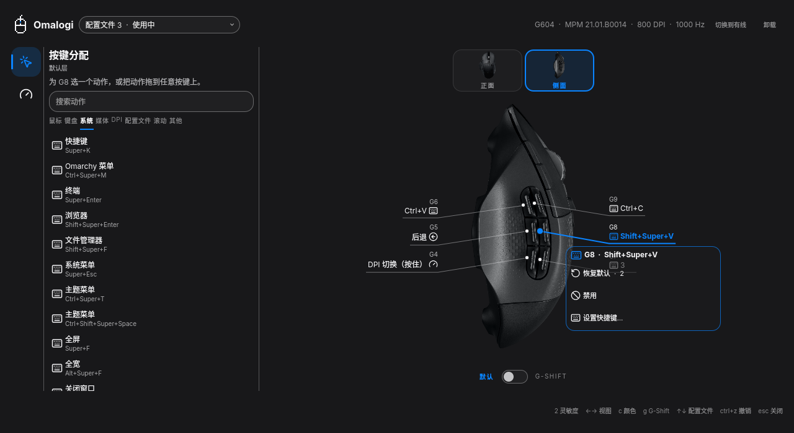

# 14 · Omalogi: Logitech G-series mouse configuration (Chinese UI + ARM build)

[简体中文](../14-omalogi.md) | English

## Goal

[Omalogi](https://github.com/elberacasa/omalogi) configures Logitech G-series mice on Omarchy, G HUB style: onboard profiles, DPI stages, report rate, button and G-Shift bindings, automatic profile switching per app / monitor, and a bar indicator. What we changed:

- **ARM (aarch64) support**: upstream only publishes x86_64 helper binaries, and the plugin's own `install.sh` exits on ARM. We build from source at the pinned 0.3.8 commit instead (Rust 1.99+, about 40 s on this machine), and the plugin's "Allow access / Install helper" buttons take that path too
- **Simplified Chinese UI**: every UI string, the action library, groups, hints, errors and the bar tooltip are in Chinese
- **A normal window**: no longer a full-screen overlay above every workspace, but a "罗技鼠标" app window that tiles / floats / goes full screen and shows up in Alt+Tab, with its own name in the menu bar and its own Dock icon
- **Wired + wireless**: with a wired mouse and a wireless one behind a receiver (e.g. G604) both connected, you choose which one to edit
- **Launcher entry and icon**: "罗技鼠标" in the Applications panel / Spotlight, with a bright blue tile matching the MacTahoe icons

## Quick start

From the Silky Omarchy checkout on Omarchy 4.x with Hyprland Lua configuration, build and install with Rust 1.99 or newer. Installing the udev rule may prompt for sudo.

```bash
./scripts/install-omalogi.sh
silky-omalogi
```

1. **Select a device.** Connect the G604 through its Lightspeed receiver. If a wired mouse is also connected, use “切换到无线” in the top-right corner.
2. **Enable an onboard profile.** Select a disabled profile (“已关闭”) in the top dropdown and click “启用并激活” to enable and activate it. For an enabled profile, click “激活”. Changes to an inactive profile take effect when you switch to it.
3. **Find the physical button.** The G604 front view labels the main buttons, wheel, and DPI controls. The side view labels G4–G9. Leader lines end just beyond their labels. Click a dot or label to select it, or drag an action from the library onto it.
4. **Build a keyboard shortcut.** Click “设置快捷键…” in the button menu. Toggle Ctrl, Shift, Alt, or Super and choose the main key. PgUp, PgDn, Home, End, and Screenshot also have one-click choices. Screenshot chooses plain Print Screen and uses the desktop's existing binding. You can also record a shortcut, review or correct it, and then click “应用” to apply.
5. **Pick a system shortcut.** On opening the app, the System tab (“系统”) reads the current `Super+K` menu and shows each supported action by name and key combination. Select a mouse button and click an action such as Terminal or Screenshot, or drag it onto a button. Search by action name or key combination. The list includes keyboard combinations Omalogi can store on the mouse.



[Preview the manual shortcut and special-key picker](../images/omalogi-shortcut.png)

## Tested hardware

| Mouse | Connection | Result |
| --- | --- | --- |
| G502 HERO | USB cable (046d:c08b) | Verified upstream; reads and writes fine; `assets.openlogi.org` has no side view for it, so there's no picture |
| G604 | Lightspeed receiver (WPID 4085) | Untested upstream, marked verified here after testing (the patch turns `untested(0x4085)` into `verified`, so no "未测试 · 帮忙验证" badge and no confirmation); all 29 `omalogi check` checks pass; front and side diagrams label all 15 programmable controls |

Machine: ARM laptop (aarch64), Omarchy 4.5, Hyprland 0.57 (Lua config), Quickshell 0.3.2, MacShell 0.5.2, Rust 1.99.1.

## Structure

Omalogi has two parts: the Rust helper `omalogi` (talks HID++ 2.0 to the mouse; provides `serve`, `daemon` and the CLI) and an Omarchy Shell plugin (QML). The plugin files are embedded into the helper with `include_str!` at build time and written to `~/.config/omarchy/plugins/io.github.elberacasa.omalogi` by `omalogi setup`, so **the translation has to be patched in before building**; editing the installed plugin is overwritten by the next `setup`.

| File | Purpose |
| --- | --- |
| `patches/omalogi-0.3.8-zh.patch` | Translation, device selection, G604 diagram, and keyboard shortcut patch against upstream `ff3d8c2` (v0.3.8) |
| `config/icons/omalogi.svg` | App icon source: Logitech cyan→blue gradient (a bright tile like Zoom's), white G-series gaming mouse, LIGHTSYNC-style cyan→blue→violet→pink light strip |
| `config/applications/io.github.elberacasa.omalogi.desktop` | Applications panel / Spotlight entry "罗技鼠标" running `silky-omalogi` |
| `omalogi-app/shell.qml`, `bin/silky-omalogi` | The standalone window app (own app id) and its open / focus script |
| `config/hypr/silky-omalogi.lua` | Window rule: centred floating 1280×700 |
| `scripts/install-omalogi.sh` | Fetch upstream → check out the pinned commit → apply the patch → `cargo build --release --locked` → install to `~/.local/bin` → install the udev rule → `omalogi setup` |

## How the translation works

- **The helper stays English**: action labels (`left click`, `DPI shift (hold)`), group names (`Mouse`, `DPI`) and errors come from Rust. CLI output, the Rust tests and the plugin's `problemKind()` (which detects "not installed / no permission / no mouse" from English error text) depend on them, so they are untouched
- **The plugin translates at display time**: `Model.js` gains `zh()` / `zhGroup()` / `zhMessage()` / `zhSource()`
  - `zh()`: exact lookup for action labels; patterns for `mouse button 7`, `key 0x64` etc.; key combos translated per part (`Right Ctrl` → `右 Ctrl`, `Space` → `空格`, arrows → arrow glyphs), while `Ctrl`, `Shift`, `F1` stay as-is
  - `zhMessage()`: regex translations of common errors (no mouse, permission denied, profile turned off, unsupported Hz / DPI…); `rule 2: …` translates the inner message recursively; anything unknown passes through
  - Labels from `actionLabel()` and `actionRows()` go through `zh()`; search matches both English and Chinese; `say()` runs everything through `zhMessage()` so the footer never leaks English
- **Hardcoded QML strings are replaced directly** in `Omalogi.qml`, `ActionLibrary.qml`, `DeviceCanvas.qml`, `SensitivityPanel.qml`, `DpiTrack.qml`
- On `aarch64` the plugin's `install.sh` hands over to this repo's `install-omalogi.sh`: the install script registers a symlink to itself at `~/.local/share/silky-omarchy/install-omalogi.sh`, so the window's "Allow access / Install helper / Update helper" buttons open a terminal that runs it (type the sudo password there for the udev rule). Only without that link does it ask you to run it by hand. Before, it just exited, which showed up as "失败（退出码 1）" after clicking "允许访问"

## A real window

Upstream Omalogi is a full-screen Omarchy shell overlay (`Overlay` layer): it stays on top across workspaces and can't be tiled, floated or Alt+Tabbed. It is now a normal window:

- the patch swaps `PanelWindow` in `Omalogi.qml` for Quickshell's `FloatingWindow` (an xdg toplevel, as Omarchy's own dev-gallery plugin does); the card fills the window, the full-screen scrim and click-outside-to-close are gone; closing it through Hyprland (Super+W, traffic lights) saves first, like Esc
- inside the Omarchy shell process the window's class would be `org.quickshell`, so the menu bar would say MacShell and the Dock would have no icon (the app id is a read-only, process-wide property). So the launcher runs it as its own Quickshell process: `omalogi-app/shell.qml` starts with `//@ pragma AppId io.github.elberacasa.omalogi` and uses the installed plugin plus Omarchy's `Commons` / `Ui` / `services` (installed to `~/.local/share/silky-omarchy/omalogi-app` as symlinks; the whole plugin folder is linked as `omalogi/` because it finds its installer at `../install.sh`). It quits once the window is closed and every save has finished
- `bin/silky-omalogi` focuses the window if it is open (switching to its workspace), else starts `qs -n -d -p …`. Hyprland uses Lua config, so `hyprctl dispatch` takes a Lua expression: `hl.dsp.focus({ window = "class:^(io\\.github\\.elberacasa\\.omalogi)$" })`; the old `focuswindow class:…` errors
- the entry is renamed `io.github.elberacasa.omalogi.desktop` with `StartupWMClass`, and the icon gets a same-named link, so the Dock matches the running window to 罗技鼠标
- `config/hypr/silky-omalogi.lua`: centred floating 1280×700, so its bottom edge stays above the Dock (the Dock auto-hides when a window covers its area; the first 1360×860 pushed it away), and a width of 1280 leaves room for the device diagram and its labels. Omarchy's floating-workspace mode shrinks new windows to 1100×760 unless the app has its own float rule; the window size is plain logical pixels, not `Style.space()` (spacing scale ≈0.83 here would shrink it and fight the rule). Super+T still tiles it
- The editor uses a solid background in the active theme’s color. Hyprland draws the shared frosted title bar on floating workspaces.
- the bar indicator (in the Omarchy shell) still opens the in-shell window; this setup uses the MacShell bar, so use the launcher entry

The [shared window controls](04-macos-theme.md#system-app-audit) check Omalogi’s 960×600 minimum. On a 1472×920 display, every half-screen and corner option is disabled. An isolated Wayland session verified the green button’s press-and-hold menu and full-screen toggle. Run `./scripts/install-omalogi.sh` to update the style, then reopen Omalogi. For a style-only rollback, restore the previous `plugin/Omalogi.qml` under `~/.config/omarchy/plugins/io.github.elberacasa.omalogi/` and reopen the app.

## Wired + wireless mice

Upstream always uses a plugged-in wired G-series mouse, so a wireless one behind a receiver (e.g. G604) can't be reached. The patch adds `~/.config/omalogi/device`: with `wireless` in it, `Session::open` and `omalogi picture` look behind receivers first and fall back to wired. The window's top-right "切换到无线 / 切换到有线" button writes that file, restarts the daemon and reloads; it refuses while edits are unsaved.

The G604 (Lightspeed receiver, WPID 4085) passes all 29 `omalogi check` checks; it is untested upstream, but after testing it here the patch marks it verified (`verified(0x4085, "G604")` in `src/hidraw.rs`, with the test's list of verified wireless models updated), so there's no "未测试 · 帮忙验证" badge and no confirmation before editing. The front diagram labels the main buttons, wheel and DPI buttons. The side diagram labels G4–G9. Each label shows the current binding and can open the manual shortcut picker or serve as a drop target for an action. The 16th onboard slot has no physical control and is hidden in the editor. A wireless mouse's picture lookup goes through the receiver and fails while the freshly started `serve` opens it, so it retries after 1.5 s, up to 3 times.

The G502 HERO has no side view on `assets.openlogi.org` (`omalogi picture` says `lists no side.png for g502_hero`), so it shows no picture; that's missing upstream art.

## Launcher entry and icon

Upstream Omalogi is only a shell plugin with no `.desktop` file, so it never appears in the Applications panel or Spotlight. We add an entry "罗技鼠标" (keywords: 罗技, 鼠标, Logitech, G502, DPI) running `silky-omalogi` (see "A real window" above).

The installer uses the blue mouse SVG included in the repository. If MacTahoe, the local icon tuner, and ImageMagick are present, it makes a rounded theme icon. Other installations use the hicolor icon theme.

The entry's `Icon=` is the generated icon's **absolute path**, not a theme name: MacShell (Quickshell / Qt) caches "icon not in theme" until the process restarts (`macshell reload` doesn't clear it), so a freshly installed icon kept showing the fallback gear (`application-x-executable`). MacShell also re-reads entries only when the applications directory changes, so the install script deletes and recreates the entry instead of rewriting it in place.

## Install

```bash
./scripts/install-omalogi.sh
```

In order: fetch upstream and check out the pinned commit → apply the translation patch → `cargo build --release --locked` → install `~/.local/bin/omalogi` → register itself for the plugin's buttons → install the udev rule (asks for sudo only when the rule changed; it only opens the hidraw nodes of Logitech G-series mice and their receivers) → `omalogi setup` → install the standalone window app (`~/.local/share/silky-omarchy/omalogi-app`, `~/.local/bin/silky-omalogi`) → install the Hyprland window rule and `hyprctl reload` → build the icon and write the launcher entry.

`--build-only` builds and installs the helper binary. The build checkout lives in `~/.cache/silky-omarchy/omalogi`. You can set `OMALOGI_SRC_DIR` to a dedicated build directory. Each run resets that checkout to the pinned commit before applying the patch.

If the Omarchy shell keeps using an old copy of the plugin after an update (`omalogi setup` says `run omarchy restart shell`), run `omarchy-restart-shell`. It restarts only the Omarchy shell, not MacShell.

`omalogi setup` writes the plugin, adds the indicator to the right of the Omarchy Shell bar, and enables the `omalogi.service` user unit (switches profiles with Hyprland focus).

Open it (or focus it when already open):

```bash
silky-omalogi
```

## Verify

```bash
file ~/.local/bin/omalogi            # ARM aarch64
omalogi --version                    # omalogi 0.3.8
systemctl --user is-active omalogi.service
omalogi info                         # with the mouse plugged in: model, firmware, DPI
omalogi check                        # run first on untested models; read-only
```

With no mouse connected the window shows "请连接鼠标 / 重试" and the footer reads "自动切换：没有找到支持的罗技鼠标…".

Window and launcher:

```bash
silky-omalogi && sleep 3
hyprctl clients -j | grep -A3 '"class": "io.github.elberacasa.omalogi"'   # one window, floating, 1280×700
silky-omalogi                                                             # a second run only focuses it
cat ~/.config/omalogi/device 2>/dev/null                                  # wireless / wired; missing means the default (wired first)
```

After closing the window, `pgrep -f omalogi-app` should print nothing (the process quits once saves finish). Switching workspaces no longer brings the window along.

After changing the patch, run `cargo test --release` in the source dir (all pass). In `node --test plugin/tests/*.test.js`, 14 cases assert the original English text and fail as expected after translation; the remaining logic cases pass.

## Problems we hit (in order)

| Symptom | Cause | Fix |
| --- | --- | --- |
| Not in the Applications panel | Upstream is only a shell plugin, no `.desktop` | Add the "罗技鼠标" entry |
| The entry showed a gear on orange | MacShell's fallback icon: Qt caches "no `omalogi` icon" until the process restarts | Absolute `Icon=` path; delete and recreate the entry |
| The first, dark icon was lost on the dark panel | Dark tile, small mouse | Bright blue gradient tile, mouse enlarged to 96% |
| "允许访问" opened a terminal that failed with exit code 1 | No udev rule yet; the plugin's `install.sh` exited on ARM | On ARM it hands over to `install-omalogi.sh`; type the sudo password there |
| Overlay too see-through to read | Menu glass sets `menu` to 55% and the overlay layer had no blur rule | Solid editor background with glass restricted to the title bar |
| Stayed on top across workspaces, no window modes | Upstream is a full-screen `Overlay` layer | `FloatingWindow` |
| Wouldn't open after a plugin change, no errors logged | The Omarchy shell kept the old plugin | `omarchy-restart-shell` |
| Menu bar said MacShell, no Dock icon | A window inside the Omarchy shell has class `org.quickshell` | Own Quickshell process + `//@ pragma AppId` |
| `hyprctl dispatch focuswindow …` failed with `')' expected` | Hyprland uses Lua config | `hl.dsp.focus({ window = "class:…" })` |
| Window 1100×760 and too low | Floating workspaces resize new windows; `Style.space()` scaled the size by 0.83 | Own float rule + logical-pixel size |
| G604 unreachable while the G502 is plugged in | Upstream always takes the wired mouse first | `~/.config/omalogi/device` + "切换到无线 / 有线" |
| G604 sometimes had no picture | The picture lookup and the starting `serve` open the receiver at once | Retry on failure |
| G604's button list ran into the Default / G-SHIFT switch | The layout reserved one row for the list | Reserve the real number of rows |
| The 1360×860 window pushed the Dock into hiding | Its bottom edge reached into the Dock's area, so the Dock auto-hid | 1280×700, which ends above the Dock when centred |
| The G604 worked but still showed "未测试 · 帮忙验证" | Upstream lists the G604 as `untested` | The patch marks it `verified` (its layout (1, 3) was already verified) |

## Upgrading upstream

1. Change `commit=` in `scripts/install-omalogi.sh` to the new release's commit
2. Check it out in the source dir, `git apply --3way` the old patch, resolve conflicts and translate new strings, then `git diff > patches/omalogi-<version>-zh.patch`
3. Re-run the install script

Don't use `omarchy plugin add` or the plugin's "Update helper": the former installs the English plugin, the latter has no ARM binary.

## Rollback

```bash
pkill -f omalogi-app
bash ~/.config/omarchy/plugins/io.github.elberacasa.omalogi/uninstall.sh
```

Removes the helper, daemon, udev rule and plugin; the mouse's profiles and backups in `~/.local/state/omalogi/backups` are kept. Then remove what this repo added:

```bash
rm -rf ~/.local/share/silky-omarchy/omalogi-app ~/.cache/silky-omarchy/omalogi
rm -f ~/.local/share/silky-omarchy/install-omalogi.sh ~/.local/bin/silky-omalogi \
  ~/.local/share/applications/io.github.elberacasa.omalogi.desktop \
  ~/.local/share/icons/silky-apps/omalogi.svg \
  ~/.local/share/icons/MacTahoe/apps/scalable/{omalogi,io.github.elberacasa.omalogi}.svg \
  ~/.config/hypr/silky-omalogi.lua ~/.config/omalogi/device
sed -i '/silky-omalogi/d' ~/.config/hypr/hyprland.lua && hyprctl reload
```

The `omalogi` entry in `scripts/tune-app-icons.py` can stay: it is skipped when its source is missing.
